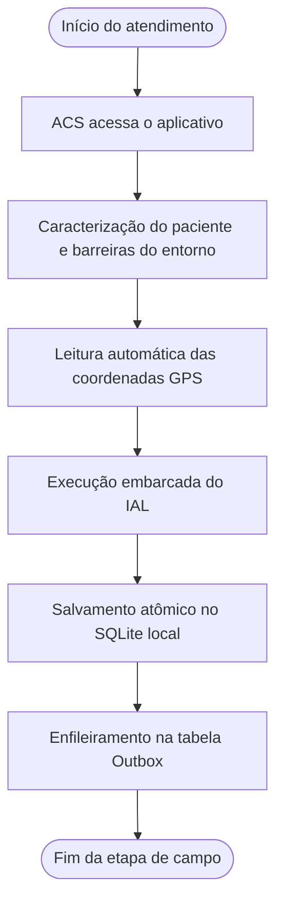
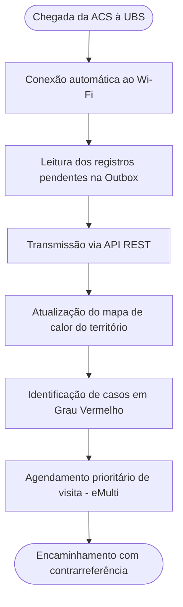
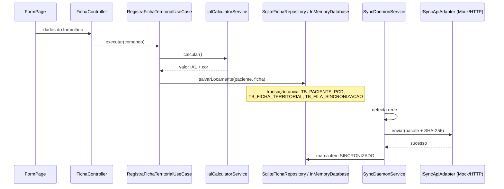
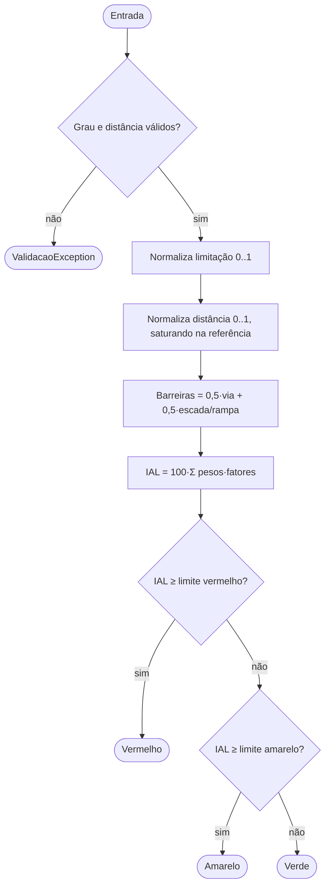
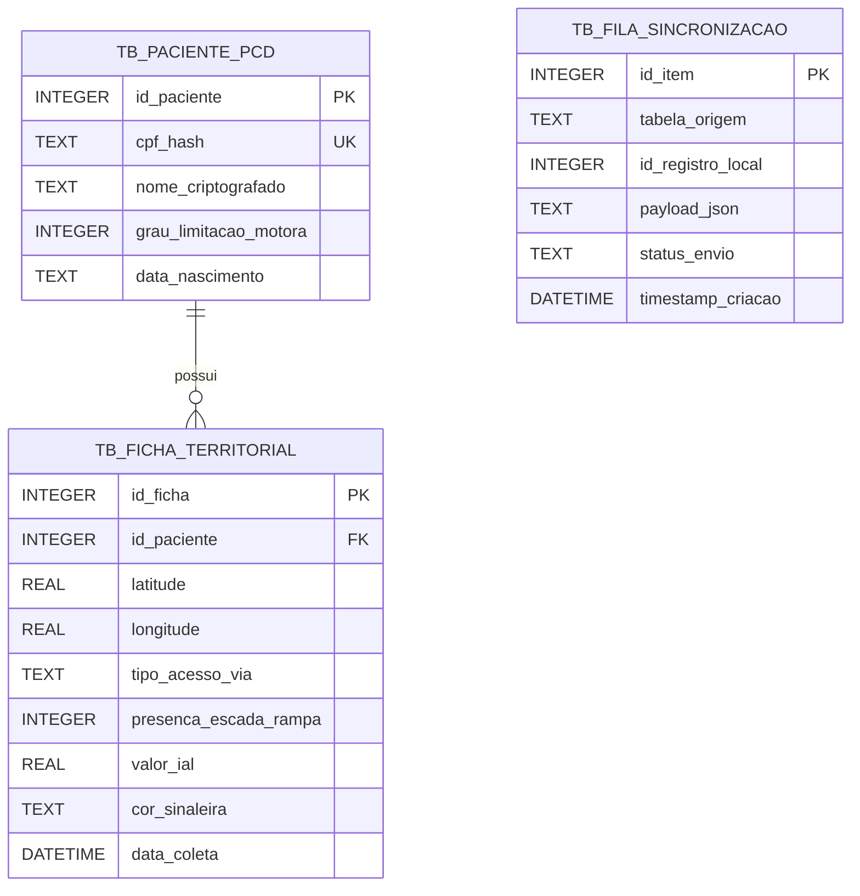

# Arquitetura e artefatos de modelagem

Diagramas em Mermaid (renderizam no GitHub/GitLab/VS Code). Os fluxos abaixo reproduzem os textos da seção 4 da especificação; **não são BPMN/UML em notação XML formal** — para isso, importe-os em uma ferramenta de modelagem.

## Hexágono (Camadas Estritamente Isoladas)

```mermaid
flowchart LR
  subgraph ADAPTERS_INPUT["Adaptadores de Entrada (Driving / UI)"]
    FichaCtrl["FichaController"]
    CidadaoCtrl["CidadaoController"]
    Pages["AcsHomePage · FichaFormPage<br/>FichasListaPage · CidadaoHomePage<br/>VisualizadorHexagonalPage"]
  end

  subgraph PORTS_IN["Portas de Entrada (Inbound / Driving Ports)"]
    IN_REG["IRegistraFichaTerritorial"]
    IN_LIST["IListarFichasTerritoriais"]
    IN_GPS["ICapturarLocalizacao"]
    IN_SYNC["ISincronizarFichas"]
    IN_CID["IConsultaFichaCidadao"]
  end

  subgraph DOMAIN["Domínio Central (Núcleo Puro)"]
    UC_REG["RegistraFichaTerritorialUseCase"]
    UC_LIST["ListarFichasTerritoriaisUseCase"]
    UC_GPS["CapturarLocalizacaoUseCase"]
    UC_SYNC["SincronizarFichasUseCase"]
    UC_CID["ConsultaFichaCidadaoUseCase"]
    DOM_SVC["IalCalculatorService · SyncDaemonService"]
    ENT_VO["PacientePCD · FichaTerritorial · ItemFilaSincronizacao<br/>CoordenadaGPS · Cpf · NivelAcessibilidade"]
  end

  subgraph PORTS_OUT["Portas de Saída (Outbound / Driven Ports)"]
    OUT_FICHA["IFichaRepository"]
    OUT_FILA["IFilaSincronizacaoRepository"]
    OUT_GPS["ILocalizacaoService"]
    OUT_API["ISyncApiAdapter"]
    OUT_CID["IConsultaFichaLocalRepository"]
    OUT_CRYPTO["IProtecaoDadosPessoais"]
  end

  subgraph ADAPTERS_OUT["Adaptadores de Saída (Driven / Infraestrutura)"]
    DB_SQL["SqliteFichaRepository<br/>(SQLCipher / AES-256)"]
    DB_MEM["InMemoryDatabase<br/>(Web / Desktop / Visualização)"]
    GPS_NATIVE["LocationServiceAdapter<br/>(GPS NATIVO)"]
    GPS_MOCK["MockLocalizacaoService<br/>(Simulado)"]
    API_HTTP["HttpCentralServerApiAdapter<br/>(Produção)"]
    API_MOCK["LocalMockSyncApiAdapter<br/>(Dev / Testes)"]
    CRYPTO_SEC["ProtecaoDadosPessoaisAdapter<br/>(Keystore/Keychain)"]
    CRYPTO_MEM["InMemoryProtecaoDadosPessoais<br/>(Puro Dart)"]
  end

  ADAPTERS_INPUT --> PORTS_IN
  PORTS_IN --> DOMAIN
  DOMAIN --> PORTS_OUT
  PORTS_OUT --> ADAPTERS_OUT
```

## 4.1 Processo — Cadastro territorial em campo

## 4.1 Processo — Sincronização e triagem na UBS

> No app móvel, só as etapas A–D estão implementadas (`SyncDaemonService`). E–H pertencem ao servidor (L-13).

## 4.2 Sequência — Sincronização offline-first

## 4.2 Atividades — Cálculo do IAL (implementação provisória, ver L-01)

## 4.3 DER

`TB_FILA_SINCRONIZACAO` referencia o registro de origem logicamente (`tabela_origem` + `id_registro_local`), sem FK, como na especificação.
